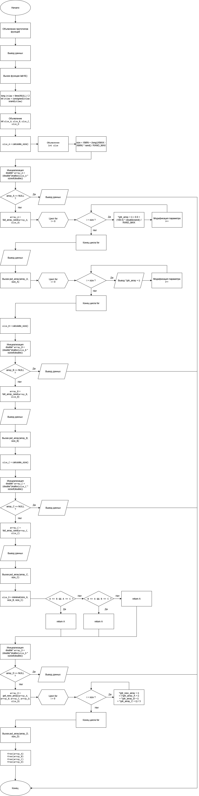

# Домашнее задание к работе 16

## Условие задачи
Сгенерировать три массива со случайными вещественными числами а0, а1, а2, ..., an, b0, b1, b2 ..., bm, с0, с1,с2, ..., сl, количество элементов случайно в интервале от 10 до 50. Реализовать функцию, которая возвращает новый массив (см. инд. Вариант). Все 4 массива вывести на экран. 
13. Массив d0, d1, d2, ..., dh каждый элемент которого определяется как среднее арифметическое соответствующих трех элементов из массивов а0, а1, а2, ..., an, b0, b1, b2 ..., bm, с0, с1,с2, ..., сl до отсутствия элементов в одном из массивов.

## 1. Алгоритм и блок-схема

### Алгоритм
1. **Начало**
2. Объявление прототипов функций
3. Вывод данных
4. Вызов функции lab16()
   - Функция выполняет задание лабораторной работы 16
   - Принимает void
   - Возвращает void
5. Установка генератора случайных значений
   - long `ltime` = time(NULL) / 2
   - int `stime` = (unsigned)`ltime`
   - srand(`stime`)
6. Объявление
   - int `size_A`, `size_B`, `size_C`, `size_D` - размеры массивов A, B, C, D
7. `size_A` = calculate_size()
   - Функция случайно рассчитывает размер массива от 10 до 50
   - Принимает void
   - Возвращает size
8. double* `array_A` = (double*)malloc(`size_A` * sizeof(double)) - инициализация массива A
9. Условный оператор if
    - if (array_A == NULL) { printf("error\n"); return -1; }
11. `array_A` = full_array_rand(`array_A`, `size_A`)
    - Функция заполняет массив случайными значениями от 0.0 до 100.0
    - Принимает double* `ptr_array`, int `size` - указатель на массив, размер
    - Возвращает `ptr_array` - указатель на массив
12. Вывод данных
13. Вызов функции put_array(`array_A`, `size_A`)
    - Функция выводит элементы массива
    - Принимает double* `ptr_array`, int `size` - указатель на массив, размер
    - Возврашает 0
14. Пункты 7 - 13 повторяются для массивов B и C
15. Для массива D повторяются пункты 7 - 9
16. `array_D` = get_new_array(`array_A`, `array_B`, `array_C`, `array_D`, `size_D`)
    - Функция заполняет массив, каждый элемент которого определяется как среднее арифметическое соответствующих трех элементов из массивов A, B и C
    - Принимает double* `ptr_array_A`, double* `ptr_array_B`, double* `ptr_array_C`, double* `ptr_new_array`, int `size` - указатели на массивы A, B, C и D, размер массива D
    - Возвращает double* `ptr_new_array` - указатель на массив D
17. Вывод данных
18. Вызов функции put_array(`array_D`, `size_D`)
19. Очищение массивов
    - free(`array_A`)
    - free(`array_B`)
    - free(`array_C`)
    - free(`array_D`)
20. **Конец**

### Блок-схема
 

## 2. Реализация программы

```
#define _CRT_SECURE_NO_WARNINGS
#define XMIN 10
#define XMAX 50
#include <stdio.h>
#include <locale.h>
#include <stdlib.h>
#include <time.h>

double* full_array_rand(double* ptr_array, int size);
int calculate_size(void);
int put_array(double *ptr_array, int size);
double* get_new_array(double* ptr_array_A, double* ptr_array_B, double* ptr_array_C, double* ptr_new_array, int size);
int minimal(int A, int B, int C);

int main(void) {

	setlocale(LC_CTYPE, "RUS");

	long ltime = time(NULL) / 2;
	int stime = (unsigned)ltime;
	srand(stime);

	int size_A, size_B, size_C, size_D;

	size_A = calculate_size();
	double* array_A = (double*)malloc(size_A * sizeof(double));

	if (array_A == NULL) { printf("error\n"); return -1; }

	array_A = full_array_rand(array_A, size_A);

	printf("МАССИВ A:\n\n");
	put_array(array_A, size_A);
	printf("\n");

	size_B = calculate_size();
	double* array_B = (double*)malloc(size_B * sizeof(double));

	if (array_B == NULL) { printf("error\n"); return -1; }

	array_B = full_array_rand(array_B, size_B);

	printf("МАССИВ B:\n\n");
	put_array(array_B, size_B);
	printf("\n");

	size_C = calculate_size();
	double* array_C = (double*)malloc(size_C * sizeof(double));

	if (array_C == NULL) { printf("error\n"); return -1; }

	array_C = full_array_rand(array_C, size_C);

	printf("МАССИВ C:\n\n");
	put_array(array_C, size_C);
	printf("\n");

	size_D = minimal(size_A, size_B, size_C);
	double *array_D = (double*)malloc(size_D * sizeof(double));

	if (array_D == NULL) { printf("error\n"); return -1; }

	array_D = get_new_array(array_A, array_B, array_C, array_D, size_D);

	printf("МАССИВ D:\n\n");
	put_array(array_D, size_D);
	printf("\n");

	free(array_A);
	free(array_B);
	free(array_C);
	free(array_D);


	return 0;
}


int calculate_size(void) {

	int size;

	size = XMIN + (long)(XMAX - XMIN) * rand() / RAND_MAX;

	return size;
}

double* full_array_rand(double* ptr_array, int size) {

	for (int i = 0; i < size; i++) *(ptr_array + i) = 0.0 + (100.0) * (double)rand() / RAND_MAX;
	

	return ptr_array;
}

double* get_new_array(double* ptr_array_A, double* ptr_array_B, double* ptr_array_C, double* ptr_new_array, int size) {

	for (int i = 0; i < size; i++) {

		*(ptr_new_array + i) = (*(ptr_array_A + i) + *(ptr_array_B + i) + *(ptr_array_C + i)) / 3;
	}

	return ptr_new_array;
}

int put_array(double* ptr_array, int size) {

	for (int i = 0; i < size; i++) {

		printf("%d элемент: %f\n", i + 1, *(ptr_array + i));
	}

	return 0;
}

int minimal(int A, int B, int C) {

	if (A <= B && A <= C) return A;
	else if (B <= A && B <= C) return B;
	else return C;

}
```

## 3. Результаты работы программы

```
МАССИВ A:

1 элемент: 16.373180
2 элемент: 85.515915
3 элемент: 99.453719
4 элемент: 33.924375
5 элемент: 30.512406
6 элемент: 4.153569
7 элемент: 52.739036
8 элемент: 69.322794
9 элемент: 70.012513
10 элемент: 54.283273
11 элемент: 79.497665
12 элемент: 8.584857
13 элемент: 40.668966
14 элемент: 35.724967
15 элемент: 78.554643
16 элемент: 10.364086
17 элемент: 51.188696
18 элемент: 18.515580
19 элемент: 1.370281
20 элемент: 85.546434
21 элемент: 23.047578
22 элемент: 25.782037
23 элемент: 65.935240
24 элемент: 68.135624
25 элемент: 40.406507
26 элемент: 96.496475
27 элемент: 30.957976
28 элемент: 5.063021
29 элемент: 43.189795
30 элемент: 18.732261
31 элемент: 58.619953
32 элемент: 80.559709
33 элемент: 16.455580
34 элемент: 74.083682
35 элемент: 43.858150
36 элемент: 40.717795
37 элемент: 79.189428
38 элемент: 83.794671
39 элемент: 38.398389
40 элемент: 33.909116
41 элемент: 25.589770

МАССИВ B:

1 элемент: 47.666860
2 элемент: 32.602924
3 элемент: 22.095401
4 элемент: 13.834040
5 элемент: 28.623310
6 элемент: 52.278207
7 элемент: 13.132115
8 элемент: 77.471236
9 элемент: 66.750084
10 элемент: 33.030183
11 элемент: 38.804285
12 элемент: 36.692404
13 элемент: 60.228278
14 элемент: 99.499496
15 элемент: 17.633595
16 элемент: 8.655049
17 элемент: 89.492477
18 элемент: 64.732810
19 элемент: 97.442549
20 элемент: 39.011811
21 элемент: 0.238044
22 элемент: 93.630787
23 элемент: 27.518540
24 элемент: 97.885067
25 элемент: 78.066347
26 элемент: 91.573840
27 элемент: 55.247658
28 элемент: 2.563555
29 элемент: 42.799158
30 элемент: 33.884701
31 элемент: 0.207526
32 элемент: 7.638783
33 элемент: 40.708640
34 элемент: 1.733451
35 элемент: 8.990753
36 элемент: 53.074740
37 элемент: 62.675863
38 элемент: 40.104373
39 элемент: 43.775750
40 элемент: 10.971404
41 элемент: 66.478469
42 элемент: 3.445540
43 элемент: 7.837153
44 элемент: 21.558275
45 элемент: 31.281472
46 элемент: 4.687643
47 элемент: 61.082797
48 элемент: 59.071627

МАССИВ C:

1 элемент: 33.155309
2 элемент: 28.751488
3 элемент: 18.146306
4 элемент: 95.187231
5 элемент: 57.069613
6 элемент: 56.416517
7 элемент: 61.336100
8 элемент: 13.821833
9 элемент: 76.259651
10 элемент: 14.380322
11 элемент: 18.402661
12 элемент: 17.133091
13 элемент: 40.656758
14 элемент: 4.632710
15 элемент: 77.962584
16 элемент: 5.517747
17 элемент: 0.286874
18 элемент: 73.451949
19 элемент: 62.169256

МАССИВ D:

1 элемент: 32.398450
2 элемент: 48.956776
3 элемент: 46.565142
4 элемент: 47.648549
5 элемент: 38.735110
6 элемент: 37.616097
7 элемент: 42.402417
8 элемент: 53.538621
9 элемент: 71.007416
10 элемент: 33.897926
11 элемент: 45.568204
12 элемент: 20.803451
13 элемент: 47.184668
14 элемент: 46.619058
15 элемент: 58.050274
16 элемент: 8.178961
17 элемент: 46.989349
18 элемент: 52.233446
19 элемент: 53.660695
```

## 4. Информация о разработчике

Лупачев Сергей бТИИ-262
